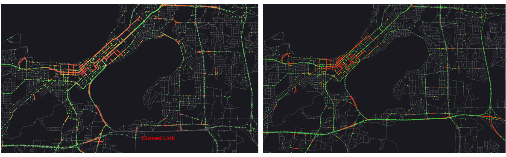
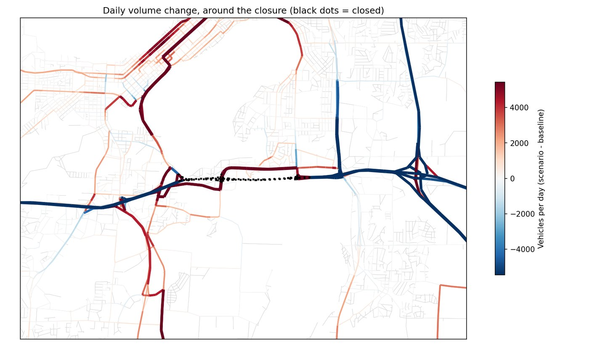
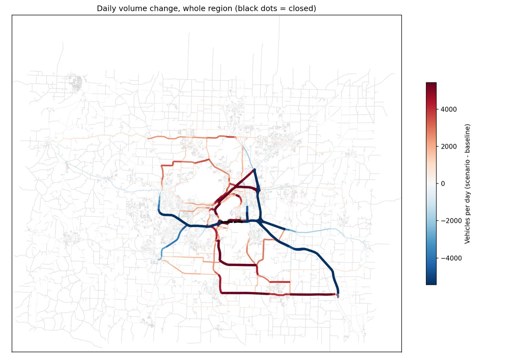

# What-If Scenarios: closed roads

Close one or more roads in a finished TAREEK run, run the simulation again, and see
where the traffic goes.

The main question this answers: **when a road segment cannot be used, how much traffic
moves onto each other road, and how much longer does travel take?**

A scenario run uses the **same people, the same planned trips, the same settings and the
same random seed** as the baseline run. The only difference is the closure, so the change
between the two runs shows the effect of the closure.



*Madison, WI, in TAREEK-Vis. Left: the scenario run, with a segment of the Beltline
closed ("Closed Link"). Right: the baseline run at the same time. Green links have
free-flow traffic, and red links are congested. In the scenario, the closed segment has
no traffic, and the traffic moves to other roads.*

---

## What you can use it for

Any event that makes one link, a few links or many links unusable for cars and trucks:

| Event | What to close |
|---|---|
| **Work zone** or road reconstruction | The links of the closed segment. |
| **Bridge closure** (repair, inspection, damage) | The bridge links, both directions. |
| **Crash** that blocks a road | The link or links where the road is blocked. |
| **Flood** | Every link in the flooded area, for example the roads near a river or in a low area. |
| **Wildfire** or other evacuation zone | Every link inside the closed zone. |
| **Snow or ice** that makes roads impassable | The roads that cannot be driven, for example steep or unplowed ones. |
| **Landslide, sinkhole, fallen trees** | The links that are blocked. |
| **Planned events** (parade, marathon, street festival) | The streets that are closed to traffic. |
| **Planning and resilience studies** | One critical link at a time (a bridge, a freeway segment), to find the links whose loss hurts the network most. |

How to read the result for these events:

- A closure lasts **all day**, and the drivers **know about it and plan around it**: the
  simulation lets them find new routes over several iterations. So the result shows the
  traffic **after drivers have adjusted**. This fits events that last days or weeks, such
  as a work zone, a bridge closure or a washed-out road.
- For a **short or sudden event**, such as a crash that blocks a road for one hour, the
  result is the effect **if the road stayed blocked all day and everyone knew in
  advance**. Read it as an upper limit of how much traffic can move to other roads, not
  as the queue behind the crash.

---

## How it works, in short

```
1. Baseline run          a normal TAREEK run (run_experiment.py)
        │
2. Pick the roads        TAREEK-Vis: Ctrl+click links ► Selected Links ► Export scenario file...
        │                (or write the JSON file by hand)
        ▼
3. Scenario run          python run_scenario.py run --base <baseline> --scenario <file>
        │                closes the links, runs MATSim again, compares the two runs
        ▼
4. Results               compare_report.html, link_changes.csv, maps
                         and a normal run folder that you can open in TAREEK-Vis
```

---

## What you need

- A **finished baseline run** in a folder under `experiments/`. The full folder is
  necessary, not only the report: `config.xml`, `network.xml`, `plans.xml`,
  `config_used.json`, and `output/` with the `ITERS` folder of the last iteration.
  The count comparison also needs `matched_devices.csv` (made by a normal run).
- The same Java and MATSim setup that ran the baseline.
- A scenario file (see below).

The scenario run reuses the baseline's network and travel demand, so it takes about as
long as the MATSim part of the baseline run.

---

## The scenario file

A small JSON file. Example:

```json
{
  "name": "hwy15_bridge_closure",
  "description": "Full closure of the Hwy 15 bridge, both directions",
  "base_experiment": "experiment_20261012_101500",
  "closures": [
    { "type": "close", "link_ids": ["48211", "48212", "51007", "51008"] }
  ]
}
```

| Field | Required | Meaning |
|---|---|---|
| `name` | yes | Letters, digits, `_` and `-` only. It becomes part of the output folder name. |
| `description` | no | Free text. It is shown at the top of the report. |
| `base_experiment` | yes | The folder name of the baseline run. The run stops if it is not the folder you give with `--base`. |
| `closures` | yes | A list with at least one closure. |
| `closures[].type` | yes | `"close"`: the links are closed to cars and trucks all day. This is the only type for now. |
| `closures[].link_ids` | yes | MATSim link IDs from the baseline's `network.xml`, as strings. |

Keys that start with `_` are comments, as in the TAREEK config files.

`closures` can hold several entries, for example one per road or one per part of an
area. All of them are closed together. A flood example:

```json
{
  "name": "river_flood_2026",
  "description": "Flood: River Road and the two low-lying streets next to it are under water",
  "base_experiment": "experiment_20261012_101500",
  "closures": [
    { "type": "close", "_road": "River Road",  "link_ids": ["7101", "7102", "7103", "7104"] },
    { "type": "close", "_road": "Mill Street", "link_ids": ["8820", "8821"] },
    { "type": "close", "_road": "Dock Street", "link_ids": ["9013", "9014"] }
  ]
}
```

**Each direction of a road is its own link.** To close a two-way road, list the links of
both directions. To close one direction only, list only that direction's links.

**How to get the link IDs.** Open the baseline's `output` folder in
[TAREEK-Vis](https://github.com/jalal1/TAREEK-Vis), Ctrl+click the links to close, and
use *Export scenario file*. The steps are in
[What-if scenarios](https://github.com/jalal1/TAREEK-Vis/blob/main/help/scenarios.md) in
the TAREEK-Vis help. You can also look up the IDs in `network.xml` and write the
file by hand. The IDs are only valid for the baseline run they come from.

**Events that cover an area** (flood, fire, snow) can need many links: select every road
in the area.

---

## Commands

Run the commands from the repository root.

### The main command

In most cases, this is the only command you need:

```bash
python run_scenario.py run --base experiments/<baseline> --scenario my_closure.json
```

- `--base` is the folder of the finished baseline run.
- `--scenario` is your scenario file.

It does everything: it closes the links, runs MATSim, and writes the compare report. The
results go to a new folder, `experiments/<baseline>__<name>/`, next to the baseline
(`<name>` is the `name` in your scenario file).

If that folder already exists, the command stops. Delete the folder, or give the scenario
a new name.

### Other options

Use these only when you need them:

| When you want to... | Command |
|---|---|
| **Check the closure before the long run.** Make the scenario folder and the closed network, but do not run MATSim. Look at `scenario_summary.json` and the log (for example, how many cut-off links were added). | `python run_scenario.py run --base experiments/<baseline> --scenario my_closure.json --prepare-only` |
| **Run MATSim after a check.** Continue a folder made with `--prepare-only`: run MATSim and write the report. | `python run_scenario.py resume --scenario-run experiments/<baseline>__<name>` |
| **Make the report again.** For example after you update TAREEK. The scenario run must be finished. MATSim does not run again. | `python run_scenario.py compare --base experiments/<baseline> --scenario-run experiments/<baseline>__<name>` |
| **Put the results in another folder.** Add this option to `run`. | `--experiments-root <dir>` |

---

## What a scenario run does

1. **Checks** the scenario file, the baseline folder and every link ID. All checks run
   before anything is written, so a bad file leaves nothing behind.
2. **Makes the scenario folder.** It copies the baseline's `config.xml` without changes,
   and every input file it names (plans, counts, transit schedule, vehicles). Large files
   are hard-linked where the file system allows it, so they use no extra disk space.
3. **Closes the links** in a copy of `network.xml`:
   - It removes `car` from the link's modes. Trucks use mode `car`, so they are closed
     out too.
   - It keeps `bus`, because a bus line is a fixed list of links (see [Limits](#limits)).
     The report lists the closed links that a bus line uses.
   - A link with no mode left gets the placeholder mode `closed`. The link stays in the
     file with its ID, so the two runs can be compared link by link.
   - Walking and cycling are not on the network in TAREEK, so they do not change.
4. **Closes the cut-off links.** Some links can no longer be used when the closure is in
   place: you can drive into them but not out, or the other way. An example is the
   stretch of freeway between the last on-ramp and the closure. These links are closed
   too, and they are listed in the report. This is also what happens in real life: the
   ramps just before a freeway closure are closed. If a closure cuts off a whole area
   (for example a neighborhood with one bridge out), every road in that area is closed,
   and the run log warns when this is more than 1% of the car network.
5. **Runs MATSim** with the copied config.
6. **Runs the normal count evaluation**, if the baseline had one.
7. **Writes the compare report** (below).

Homes, workplaces and other activities are stored as points. MATSim puts each one on the
nearest link that allows cars, so no activity is placed on a closed link. For people who
live or work on a closed road, or inside a closed area, the trips start and end at the
nearest open road.

---

## The results

In the scenario folder:

| File | What it is |
|---|---|
| `compare_report.html` | The report (also `compare_report.md`). |
| `link_changes.csv` | One row per car link: link ID, road name, road type, length, lanes, capacity, `closed` (`selected`, `cut_off` or empty), daily volume before and after, change, change %, low-volume flag, and the change in each hour (`change_h00` … `change_h23`). |
| `compare/` | The two map figures used in the report. |
| `scenario.json` | A copy of the scenario file. |
| `scenario_summary.json` | What was closed, the cut-off links, the closed links on bus lines, run time and status. |
| `output/` | The normal MATSim output. Open it in TAREEK-Vis like any other run. |

### The compare report

1. **How to read this report.**
2. **What was closed:** the selected links and their length, the volume of the busiest
   closed link (the traffic that must find another route), the cut-off links by road
   type, and the closed links on bus lines.
3. **Network totals:** vehicle-km, vehicle-hours and delay per day, before and after.
4. **Maps** of the daily volume change: the whole region, and zoomed to the closure. Red
   roads gained traffic, blue roads lost traffic.
5. **Roads with the most added and the most lost traffic**, one row per road (see
   **Road** below).
6. **Count fit, before and after**, and a table per count station.

**Example maps.** These are the two maps of a test run in Madison, WI: a full closure of
about 2.1 km of the Beltline, both directions. The scenario file selected 12 links, and
the cut-off check closed 41 more freeway and ramp links.



*Around the closure. The black dots are the closed links. The Beltline east and west of
the closure loses traffic (blue). The traffic moves to John Nolen Drive, to the roads
through downtown, and to the local roads south of the closure (red).*



*The whole region. The closure also changes routes far from it: traffic moves from the
freeways to roads around the lakes and to county roads in the south.*

### How to read the numbers

- Volumes are vehicles per day: cars, trucks and buses together. They come from MATSim's
  link statistics of the last iteration (which MATSim can average over the last few
  iterations), scaled up to the full population by `1 / flowCapacityFactor`.
- **Low volume:** fewer than 50 simulated vehicles per day on a link in both runs. The
  change on such a link is mostly random variation, so it is left out of the maps and the
  road tables. It is still in the CSV.
- **Road:** the links with the same name that are connected, or less than 300 m apart
  (the two sides of a divided road). Two roads with the same name in different places
  (a "3rd Street" in two towns) are two rows, and the label names a nearby road. Links
  with no name, often freeways and ramps, are grouped the same way by road type, and the
  label names the two nearest big roads, for example "(no name), near South Beltline
  Highway and Marsh Road". An unnamed roundabout is one row, "(roundabout)". Connected
  unnamed freeways can form one long row; the **Link** column shows where the biggest
  change is.
- **Km affected:** the length of a road whose change is at least 20% of that road's
  biggest change. One direction is counted.
- **Count stations inside the closure.** A count station on a closed link has 0 vehicles
  in the scenario, but its count is real traffic without a closure. This pulls the count
  fit down a lot. The report also shows the fit without these stations. Read that row to
  see whether the closure changed the fit at the other stations.

---

## Limits

- **All-day closures that drivers know about.** Closures by hour or by date are not
  supported yet, and surprised drivers and the queues behind a sudden event are not
  modeled. See [How to read the result for these events](#what-you-can-use-it-for).
- **Full closures only.** Lane reductions and lower speeds (a lane blocked by a crash,
  light snow, rain) are not supported yet.
- **The trips stay the same.** Nobody cancels a trip, stays home or leaves the area
  because of the event. People change their routes, and they can also change what the
  baseline's replanning settings allow (by default, their departure times and their
  travel mode). For a large flood, a fire or a storm, real travel demand would also
  change.
- **No area selection yet.** A tool that closes all links inside a drawn area is not
  available; for an area event, every link must be listed.
- **Buses still drive through a closure.** Bus lines are not rerouted.
- **Small random variation.** The two runs use the same seed, but a small part of the
  change is random. Small changes can be noise; see **Low volume** above.
- **Local roads are not checked against counts.** Count stations are mostly on state
  highways. Read local road volumes as the likely direction and size of a change, not as
  exact numbers.
- **No through traffic for cars.** TAREEK does not make car trips that only pass through
  the region. In a small region, the model can send too much diverted traffic onto local
  streets and too little onto long detours.
- **Region edge.** If a closure is near the edge of the modeled region, some of the
  detour routes may be outside the model.
- **TAREEK-Vis and the CSV count differently.** TAREEK-Vis counts vehicles from the last
  iteration's events; the report uses the link statistics (see
  [How to read the numbers](#how-to-read-the-numbers)). Compare TAREEK-Vis with
  TAREEK-Vis, and the CSV with the CSV.
